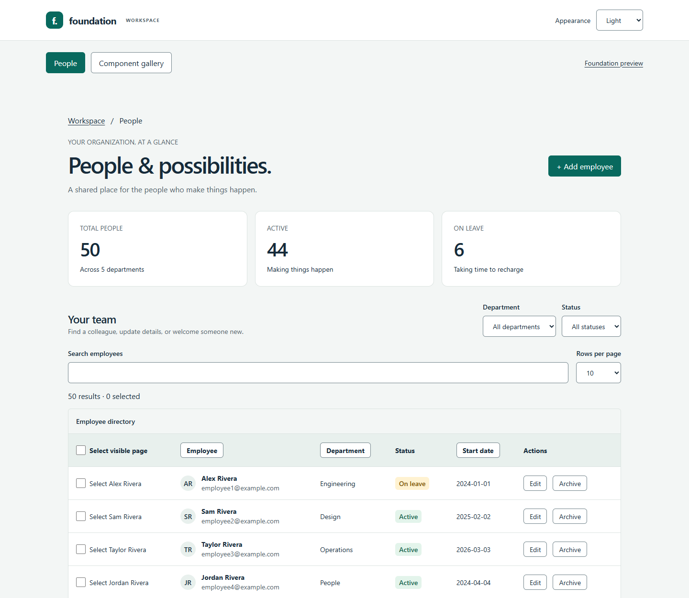
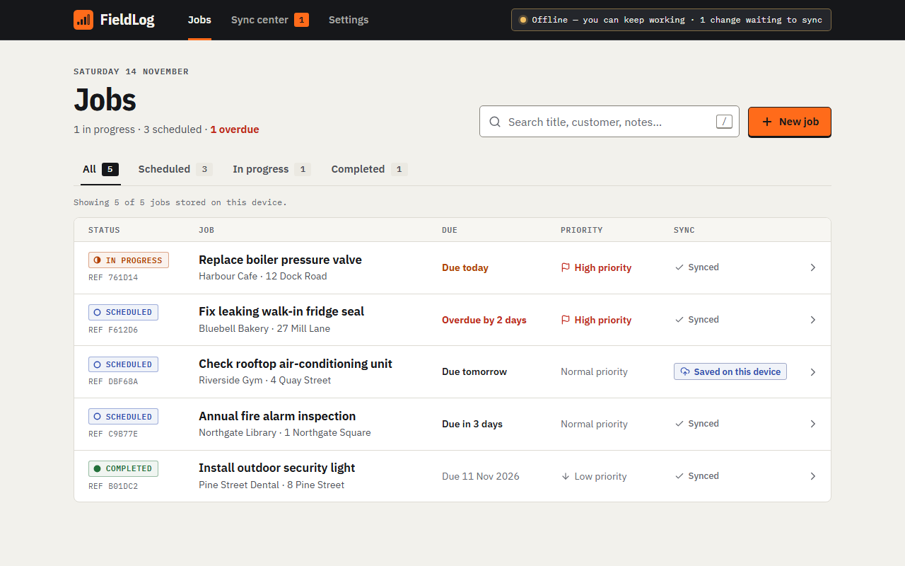
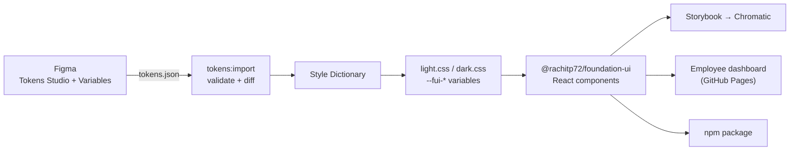

# Nexvia Technologies internship: FE-01 and FE-03

Final submission by **Rachit Panwar** (Frontend Development). This repository holds both allotted
projects, each in its own folder with its complete source code, tests, documentation and
screenshots.

| Folder | Project | What it is | Live | Original repository |
|---|---|---|---|---|
| [`FE-01/`](FE-01/) | **Foundation UI** | Accessible, token-driven React component library (44 components), published on npm | [Demo](https://rachit1234766.github.io/F3-02/) · [Storybook](https://main--6adb1ea72d119416b1620b45.chromatic.com/) · [npm](https://www.npmjs.com/package/@rachitp72/foundation-ui) | [F3-02](https://github.com/rAcHiT1234766/F3-02) |
| [`FE-03/`](FE-03/) | **FieldLog** | Offline-first field-service job tracker, a Vue 3 Progressive Web App with Firebase sync | [App](https://fe-03-56215.web.app) | [F3-03](https://github.com/rAcHiT1234766/F3-03) |

Each folder has its own full README: [FE-01/README.md](FE-01/README.md) and
[FE-03/README.md](FE-03/README.md).

| FE-01 Foundation UI: employee dashboard built with the library | FE-03 FieldLog: jobs list while offline |
|---|---|
|  |  |

## Repository layout

```
FE-01/   Foundation UI (npm workspaces)
  packages/tokens/   Figma token import, validation, Style Dictionary build
  packages/ui/       the component library, one folder per component, with stories and tests
  apps/demo/         employee dashboard and component gallery that use the library
  scripts/           browser, contrast, package, performance and Chromatic checks
  docs/              architecture, API, decisions, test results, NVDA review, reflection, images
FE-03/   FieldLog (single Vite app)
  src/               Vue screens, Dexie storage, sync engine, service worker, push
  tests/             unit (Vitest), emulator (Firestore rules and sync), e2e (Playwright)
  firestore.rules    access policy
  docs/              architecture, sync protocol, decisions, test matrix, evidence, reflection, slides, images
.github/workflows/ci.yml   runs both projects' checks on every push
```

## Getting started

Clone once, then work inside the project folder you want. The two projects are independent:
each has its own `package.json` and lock file.

```bash
git clone https://github.com/rAcHiT1234766/nexvia-internship-projects.git
cd nexvia-internship-projects
```

| | FE-01 Foundation UI | FE-03 FieldLog |
|---|---|---|
| Needs | Node 24 (`FE-01/.nvmrc`), npm 10+ | Node 22.18+ or 24.12+, npm, Java 21+ (Firestore emulator) |
| Install | `cd FE-01` then `npm ci` | `cd FE-03` then `npm ci` |
| Run | `npm run dev:demo` → dashboard on http://127.0.0.1:5173 <br> `npm run dev` → Storybook on http://localhost:6006 | `npm run emulators`, then in a second terminal `npm run dev:emulator` → http://localhost:5173, choose **Create emulator account** |
| Check | `npm run check` (lint, types, tokens, contrast, tests, builds) | `npm run check` (lint, types, unit tests, build) |
| More tests | `npm run test:coverage`, `npm run test:browser`, `npm run test:storybook` | `npm run test:rules`, `npm run test:sync`, `npm run test:e2e` |

FieldLog's emulator mode needs no Firebase account and refuses any project that is not a local
`demo-` project, so it can never touch real data.

---

## FE-01 Foundation UI

A React 19 + TypeScript component library whose colours, spacing, radius and type come from
**Figma** design tokens, built into light and dark themes by **Style Dictionary**, documented in
**Storybook**, visually tested with **Chromatic**, published to **npm**, and used by a working
**employee dashboard**.

**Features**

- **44 components** in six groups: basics, layout, forms, navigation, overlays, and data and
  dates (Table, DataGrid with sort, search, paging and row selection, Calendar, DatePicker,
  Combobox).
- **Figma → code tokens.** Tokens Studio export → `npm run tokens:import` (validates and shows
  every changed value) → Style Dictionary → `--fui-*` CSS variables for both themes.
- **Accessibility first (WCAG 2.2 AA target):** labelled fields, announced errors, focus-trapping
  dialogs that restore focus, keyboard-operable menus, tabs, calendar and combobox.
- **Theming** by `data-ui-theme="light" | "dark"` on any container, nestable; portalled overlays
  follow the theme of the element that opened them.
- **Ships compiled CSS and one ES module per component**, so an app that imports only `Button`
  does not bundle the calendar. No Tailwind setup is needed by consumers.

**Architecture**



Components build on Radix UI primitives (dialogs, menus, popovers, tabs, toast, tooltip) and
react-day-picker (calendar), or on native elements (Button, Input, Checkbox, Select, Table,
DataGrid, Combobox). Details: [architecture](FE-01/docs/architecture.md),
[API](FE-01/docs/api.md), [decisions](FE-01/docs/decisions.md).

**Results**

| Check | Result |
|---|---|
| Behaviour tests | 72 Jest + Testing Library tests; coverage 97.4% statements, 90.4% branches, 98.4% lines |
| Interaction tests | 13 Storybook keyboard and focus tests pass in Chrome |
| Automated accessibility | axe on all 204 stories in Chrome: 0 violations; also in Jest and on the dashboard in both themes |
| Manual screen-reader review | NVDA 2026.3 + Chrome on the dashboard: 18 of 18 checks pass |
| Visual regression | Chromatic snapshots of every story; a deliberate one-line CSS regression was caught in 57 snapshots and denied |
| Performance | Lighthouse 100 / 100 / 100 / 100 (desktop); DataGrid with 10,000 rows updates in under 6 ms |
| Release | `@rachitp72/foundation-ui@0.2.0` on npm (MIT), installed and tested in a separate app |

Evidence: [test results](FE-01/docs/test-results.md), [NVDA review](FE-01/docs/manual-review.md),
[component inventory](FE-01/docs/component-inventory.md), [reflection](FE-01/docs/reflection.md),
[project status](FE-01/PROJECT-STATUS.md).

---

## FE-03 FieldLog

A field technician's job tracker that keeps working without a signal. Jobs are saved on the
device first (IndexedDB) and synchronise with the same account's Firestore data when the
connection and sign-in allow.

**Features**

- **Offline-first.** After one online visit the app and the jobs on the device work with no
  connection. Create, edit, delete and change status offline.
- **Save means saved.** One IndexedDB transaction writes the job together with its queued sync
  operation, so a save can't be half-done.
- **Safe sync.** Delivery is at least once, effects happen once: retries reuse the operation ID
  and a server receipt makes repeats harmless.
- **Field-level conflict handling.** Edits to different fields both survive; for the same field
  the last server commit wins and the other value is shown in the Sync center. A stale offline
  edit cannot bring a deleted job back.
- **Installable PWA** (Workbox service worker) with **push notifications** through Firebase Cloud
  Messaging. Installed, used in airplane mode and sent a real push on an Android phone.
- **Accessible interface:** light and dark themes, forced-colours and reduced-motion support,
  status never shown by colour alone, 44 px touch targets, skip link, visible focus.
- **Account separation** on a shared device, and a JSON export so local work is never trapped.

**Architecture**

```
Vue screens ──save──▶ Dexie: jobs + outbox (one transaction) ──▶ UI (live queries)
                                   │
                         sync engine (Web Lock per account)
                                   │  reconcile → push batch → reconcile
                                   ▼
          Firestore transaction: read receipt → read job → merge → write job + receipt
Workbox service worker: precached app shell for offline use + FCM background messages
```

Details: [architecture](FE-03/docs/architecture.md),
[sync protocol](FE-03/docs/sync-protocol.md), [decisions](FE-03/docs/decisions.md),
[PWA checklist](FE-03/docs/pwa-checklist.md).

**Results**

| Check | Result |
|---|---|
| Static checks and unit tests | oxlint + ESLint clean, `vue-tsc` clean, Vitest 83 of 83, production build OK |
| Security rules | 21 of 21 Firestore rule tests pass against the emulator |
| Sync protocol | 17 of 17 tests with two independent clients against the Auth and Firestore emulators |
| Browser scenarios | 14 Playwright scenarios pass in Chromium (offline, tabs, session, service-worker update) |
| Scenario matrix | T01–T48, each with its status and evidence ([test matrix](FE-03/docs/test-matrix.md)) |
| Lighthouse (sign-in page) | Desktop 100 / 100 / 100 / 100; mobile performance 88, other categories 100 |
| Real device | Installed on an Android phone, used in airplane mode, real push received |

Evidence: [evidence report](FE-03/docs/evidence.md),
[requirements checklist](FE-03/docs/requirements-checklist.md),
[progress](FE-03/docs/progress.md), [reflection](FE-03/docs/reflection.md), screenshots in
[FE-03/README.md](FE-03/README.md#screenshots).

---

## Presentations and reflections

| | FE-01 Foundation UI | FE-03 FieldLog |
|---|---|---|
| Slides | [PDF](FE-01/docs/presentation/foundation-ui-slides.pdf) | [PowerPoint with speaker notes](FE-03/docs/presentation/fieldlog-final-presentation.pptx) |
| Recorded talk | 9:10, live demo from about 3:40 to 6:08 | 10:41, live demo from about 3:00 to 5:15 |
| Reflection | [FE-01/docs/reflection.md](FE-01/docs/reflection.md) | [FE-03/docs/reflection.md](FE-03/docs/reflection.md) |

The recorded talks are in the Google Drive submission folder (FE-01 → `06-Presentation`,
FE-03 → `05-Presentation`), not in this repository.

## Continuous integration

[`.github/workflows/ci.yml`](.github/workflows/ci.yml) runs on every push and pull request:

- **FE-01:** `npm run check`, test coverage, Storybook build, Storybook interaction and axe tests,
  and the packed-library check.
- **FE-03:** static checks and unit tests, then the Firestore emulator suites (rules and sync) and
  the Playwright browser scenarios.

## How this repository was put together

Both projects were first built in their own repositories, which are still public and still
deploy the live sites: [F3-02](https://github.com/rAcHiT1234766/F3-02) publishes the
Foundation UI demo to GitHub Pages and [F3-03](https://github.com/rAcHiT1234766/F3-03) is
deployed to Firebase Hosting. Each project was brought into this repository with
`git subtree add`, so **its full commit history is kept with the original commit IDs**. Commit
IDs quoted in the project documents can be found here too (for example `git show 7685a68`).
The workflow files inside `FE-01/.github/` and `FE-03/.github/` are the originals from those
repositories; GitHub runs only the root workflow in this one.

The jobs, customers and accounts in the screenshots are fictional. Real e-mail addresses that
appeared in the FE-01 recording are blurred.
